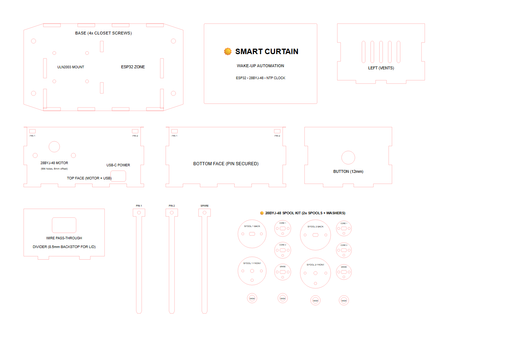

# Solarpunk ☀️

An open-source, local-first IoT smart curtain automation built with an **ESP32**, a **28BYJ-48 stepper motor**, an interlocking laser-cut wooden enclosure, and an embedded responsive mobile dashboard.

Designed for natural morning wake-ups by gently drawing your curtains at scheduled times or on-demand via web, physical button, or local automation.



---

## Features

- **100% Local-First & Private:** Operates entirely within your local network. No external cloud servers, no account registration, and no third-party tracking.
- **Responsive Mobile Dashboard:** Built-in web UI with instant controls, visual status, wake-up schedule configuration, and live tuning of motor distance and cord slack release.
- **Precision Morning Wake-Up:** Dual NTP time synchronization (Japan Standard Time / GMT+9 default, configurable) with persistent flash storage (`Preferences`). Survives power cuts and reboots without losing schedule.
- **Smooth Half-Stepping Motion:** Custom 8-step half-stepping sequence drives the 28BYJ-48 stepper motor with maximum torque, minimal vibration, and automatic anti-snag slack release.
- **Dual Physical & Wireless Control:**
  - Physical 12mm momentary push-button mounted to the side of the case for direct bedside toggle.
  - mDNS hostname discovery: navigate straight to `http://curtain.local` on your phone or laptop.
  - Over-The-Air (OTA) wireless firmware updates (`ArduinoOTA`).
- **Precision Laser-Cut Enclosure & Spool Kit:**
  - Parametrically generated in Python (`enclosure/generate_case.py`).
  - Sized strictly for standard **450 mm × 300 mm × 3.0 mm** wood / MDF sheets.
  - **Inset base tabs** preventing corner joint interference during assembly.
  - **Custom 28BYJ-48 Wooden Spools**: Includes 2 complete 4-layer spools with exact 5.0 mm × 3.0 mm D-shaft keyways, anti-slip cord anchor holes, and 3mm motor spacer washers (no bobbins or 3D printer required).
  - Sliding front service panel secured with low-profile gravity-hung T-pins (no screws needed to access the internals).
  - 4-point wardrobe screw mount ears for rock-solid stability.
  - Integrated cable divider acting as a mechanical backstop for the sliding front lid.

---

## Bill of Materials (BOM)

| Component | Quantity | Specification / Description |
| :--- | :--- | :--- |
| **Microcontroller** | 1 | ESP32 Development Board (ESP32-WROOM-32 / 30-pin or 38-pin) |
| **Stepper Motor** | 1 | 28BYJ-48 5V Geared Stepper Motor |
| **Motor Driver** | 1 | ULN2003 Stepper Driver Module |
| **Push Button** | 1 | 12mm Momentary Push Button (Vitalux or similar) |
| **Wood Plank** | 1 | 3.0 mm Plywood or MDF (minimum 450 mm × 300 mm) |
| **Mounting Screws** | 4 | M4 Wood Screws (for fastening the enclosure to wardrobe/wall) |
| **Motor Screws** | 2 | M4 Machine Screws & Nuts (or M3.5/M4 self-tapping screws) |
| **Power Supply** | 1 | 5V USB-C Power Adapter (min 1.5A) and USB-C Cable |
| **Jumper Wires** | ~10 | Female-to-Female DuPont jumper wires |
| **Drive Spool** | 2 | Included directly on the laser cut plank (exact 28BYJ-48 D-shaft fit) |

---

## Wiring & Pinout

```
+-----------------------------------------------------------+
|                        ESP32 BOARD                        |
|                                                           |
|  GPIO 26 ------------------------> IN1 (ULN2003 Driver)   |
|  GPIO 25 ------------------------> IN2 (ULN2003 Driver)   |
|  GPIO 33 ------------------------> IN3 (ULN2003 Driver)   |
|  GPIO 32 ------------------------> IN4 (ULN2003 Driver)   |
|                                                           |
|  GPIO 27 ------------------------> Push Button (Terminal 1)|
|  GND     ------------------------> Push Button (Terminal 2)|
|                                                           |
|  VIN (5V) -----------------------> 5V Power (+ on ULN2003)|
|  GND     ------------------------> GND (Ground on ULN2003)|
+-----------------------------------------------------------+
```

> [!NOTE]
> GPIO 27 uses an internal `INPUT_PULLUP` resistor. Simply connect one terminal of your momentary button to GPIO 27 and the other to GND.

---

## Repository Structure

```
Solarpunk/
├── .gitignore                    # Protects secrets, build output, and OS files
├── LICENSE                       # Creative Commons CC BY-NC 4.0 License
├── README.md                     # Documentation & setup guide
├── CurtainOpener/                # Primary ESP32 firmware
│   ├── CurtainOpener.ino         # Main Arduino sketch (Web dashboard, stepper, NTP, OTA)
│   ├── secrets.h.example         # Wi-Fi credentials template (safe for Git)
│   └── secrets.h                 # Local private Wi-Fi credentials (git-ignored)
├── CurtainOpener_Test/           # Diagnostic test sketch
│   └── CurtainOpener_Test.ino    # Motor direction, speed, and button check
├── CurtainOpener_Scan/           # Network diagnostic sketch
│   └── CurtainOpener_Scan.ino    # 2.4GHz Wi-Fi RSSI scanner
└── enclosure/                    # Laser-cut enclosure CAD & generators
    ├── generate_case.py          # Parametric SVG & DXF box generator
    ├── export_dxf.py             # AutoCAD R12 DXF export module
    ├── curtain_case_3mm.svg      # Laser cut vector layout (450 x 300 mm plank)
    ├── curtain_case_3mm.dxf      # DXF CAD export with CUT and ENGRAVE layers
    └── curtain_case_preview.png  # High-resolution assembly layout preview
```

---

## Quickstart & Firmware Setup

### 1. Configure Wi-Fi Credentials
Copy the example credentials file in `CurtainOpener/`:
```bash
cp CurtainOpener/secrets.h.example CurtainOpener/secrets.h
```
Edit `CurtainOpener/secrets.h` with your local Wi-Fi SSID and password:
```cpp
#pragma once
const char* WIFI_SSID     = "Your_WiFi_Network";
const char* WIFI_PASSWORD = "Your_WiFi_Password";
```
*(Note: `secrets.h` is excluded by `.gitignore` to keep your credentials private).*

### 2. Compile and Upload

#### Option A: Using Arduino IDE
1. Install the **esp32** board package by Espressif (`https://raw.githubusercontent.com/espressif/arduino-esp32/gh-pages/package_esp32_index.json` under *Boards Manager*).
2. Select your board: **ESP32 Dev Module** (or your specific ESP32 variant).
3. Connect your board via USB, select the corresponding COM/tty port, and click **Upload**.

#### Option B: Using Arduino CLI
```bash
arduino-cli compile --fqbn esp32:esp32:esp32 CurtainOpener
arduino-cli upload -p COM3 --fqbn esp32:esp32:esp32 CurtainOpener
```

### 3. Over-The-Air (OTA) Updates
Once running on your Wi-Fi network, the device supports Arduino OTA flashing without needing a physical USB connection:
```bash
arduino-cli upload -p curtain.local --fqbn esp32:esp32:esp32 CurtainOpener
```

---

## Web Dashboard & Operation

1. Connect your phone or PC to the same Wi-Fi network.
2. Open a browser and navigate to:
   ```
   http://curtain.local
   ```
   *(If your network does not support mDNS, open the Serial Monitor at 115200 baud to find the device's assigned local IP address).*
3. **Dashboard Controls:**
   - **Quick Actions:** Tap **OPEN CURTAIN** or **CLOSE CURTAIN** for immediate operation.
   - **Wake-Up Alarm:** Enable the daily alarm and select the desired wake-up time (e.g., 07:00 AM).
   - **Calibration:** Fine-tune the total travel rotation steps and reverse slack-release steps to match your window width and cord tension.
   - Settings are stored directly to the ESP32's flash memory.

---

## Laser-Cut Enclosure Fabrication

The enclosure is optimized for cutting on standard laser cutters (e.g. Epilog Mini 24, K40, OMTech, xTool):
- **Stock Material:** 3.0 mm Plywood or MDF
- **Plank Dimensions:** 450 mm × 300 mm
- **Color Mapping:**
  - **RED (`#FF0000`, 0.1 mm stroke):** Vector Cut (through-material cut)
  - **BLACK (`#000000`):** Raster Engrave / Surface Etch (labels and alignment guidelines)

### Generating Custom Sizes
If using a different plank dimension or material thickness, adjust the parametric constants at the top of `enclosure/generate_case.py` and run:
```bash
python enclosure/generate_case.py
```
This regenerates both `curtain_case_3mm.svg` and `curtain_case_3mm.dxf`.

### Assembly Guide
1. **Glue Base & Outer Ring:**
   - Glue the 4 vertical walls (Top, Bottom, Left with vents, Right with 12mm button hole) into a rectangular ring.
   - Drop the assembled wall ring into the base plate mortises. The inset base tabs guarantee clean 90° corners without joint interference.
2. **Mount Hardware & Assemble Spool:**
   - Fasten the 28BYJ-48 motor to the top panel using 2x M4 screws through the 4.2mm holes.
   - Install the 12mm momentary push button into the side panel hole.
   - Secure the ULN2003 driver and ESP32 board in their designated zones using hot glue or small M2/M3 standoffs.
   - Assemble the wooden spool: stack Back Flange, 2x Core Disks, and Front Flange with a thin layer of wood glue. Pass two standard toothpicks through the 2.2mm alignment holes to hold them concentric while the glue sets, then snip flush.
   - Slide the 3mm spacer washer onto the motor shaft, followed by the assembled spool.
   - Insert the Internal Divider into its floor mortises to isolate cables from the drive mechanism.
3. **Mount Enclosure to Wardrobe:**
   - Fix the box securely to the side or top of your closet using 4x M4 wood screws through the base plate corner ears.
4. **Slide-in Front Hatch & Gravity Pins:**
   - Slide the front faceplate into the front cavity against the divider stops.
   - Drop the two T-shaped locking pins into the top holes through to the bottom. Gravity keeps the pins seated; simply pull them out whenever internal access is required.

---

## License

This project is licensed under the **Creative Commons Attribution-NonCommercial 4.0 International License (CC BY-NC 4.0)** - see the [LICENSE](LICENSE) file for the full legal text.

### Summary of Rights:
- **Free for Personal / DIY Use**: You are free to download, build, modify, and share this project for personal, educational, and hobbyist purposes.
- **Attribution**: You must give appropriate credit and link to the source repository.
- **Commercial Use Restricted**: Selling physical units, kits, pre-cut enclosures, or using this design/software for commercial advantage or monetary compensation is **not permitted** under this license.

> [!NOTE]
> For commercial licensing, kit manufacturing rights, or royalty contract inquiries, please contact the repository owner directly.
