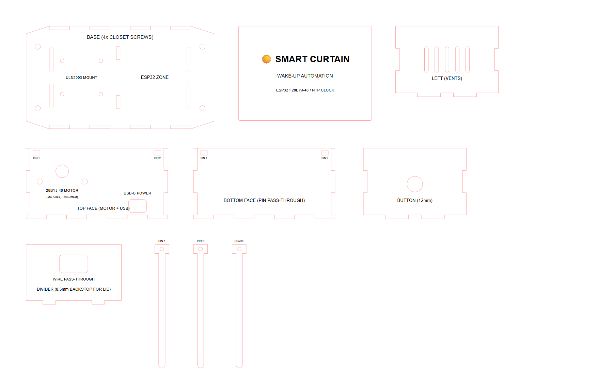
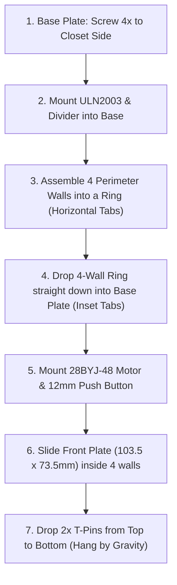

# 3.0mm Laser-Cut Enclosure Guide

This enclosure houses the **ESP32 DevKit**, the **28BYJ-48 Stepper Motor**, the **ULN2003 Driver Board**, and the **12mm Push Button** in a vertical orientation mounted flat against the side of a wardrobe or closet.

---

## 🎯 Mechanical Refinements Implemented

### 1. Inset Base Tabs on Side Walls (Zero Corner Binding)
- **The Issue**: Previously, the side walls had base tabs right at the corner, creating an awkward double-tab "L-notch" where vertical side tabs and bottom base tabs met. In 3D assembly, tabs in two perpendicular directions at the exact corner lock each other out and bind.
- **The Solution (Inset Tabs)**:
  - Both bottom corners of the side walls are now **completely flat for 14.0 mm**.
  - The base tabs are shifted into the mid-span: **two 18.0 mm tabs** separated by a 10 mm gap.
  - The Base Plate mortises match this inset position (`y = 32..50 mm` and `y = 60..78 mm`), leaving **14 mm of solid wood** at all corners of the base plate.
  - **Assembly Benefit**: The 4 perimeter walls assemble into a square ring first via their horizontal finger joints, and then the ring drops straight down into the base plate smoothly with zero binding!

### 2. Strict 450 mm × 300 mm Plank Boundaries
- All 8 parts are arranged in a spacious 3-row layout:
  - **Row 1**: Base Plate (146 × 80 mm), Front Lid (103.5 × 73.5 mm), Left Wall (74 mm body).
  - **Row 2**: Top Face (110 × 55 mm), Bottom Face (110 × 55 mm), Right Wall (74 mm body).
  - **Row 3**: Internal Divider (74 × 46.5 mm), 3x Link Pins (96 mm long).
- **Safe Margins**: Max X = **382 mm** (68 mm right margin), Max Y = **281 mm** (19 mm bottom margin).

### 3. Side Walls Body Length Corrected
- Body length is **74.0 mm** (inner span between Front and Back walls). Outer span with tabs is **80.0 mm**, sitting completely flush with zero overhang.

### 4. Front Plate / Removable Lid Resized for Internal Fit
- Resized to **103.5 mm × 73.5 mm** (`rx = 1.0 mm`), leaving 0.5 mm total clearance inside the 104 × 74 mm cavity.

### 5. 100% Square Orthogonal Finger Joints
- All finger joints and tab steps are 90-degree orthogonal cuts with zero 45-degree diagonal chamfers.

### 6. Motor Mount Screw Holes Enlarged for M4
- Enlarged to **4.2 mm diameter** (`r = 2.1 mm`) for standard M4 screws with the accurate 8.0 mm shaft offset.

---

## 📐 Laser Cut Parameters

| Parameter | Value | Notes |
| :--- | :--- | :--- |
| **Plank Dimensions** | 450 mm × 300 mm | Standard plywood / MDF / basswood plank |
| **Active Cut Extents** | 382 mm × 281 mm | Generous 68mm right & 19mm bottom clearance |
| **Material Thickness** | 3.0 mm | Standard laser plywood / acrylic / MDF |
| **Vector Cut Lines** | `#FF0000` (Red) | 0.001 in (0.1 mm hairline), Vector Mode |
| **Raster Engravings** | `#000000` (Black) | Raster Mode (Text labels, logo, and pin guides) |

---

## 🛠️ Assembly Sequence

